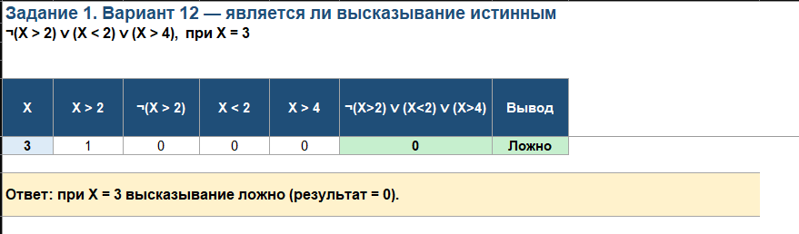
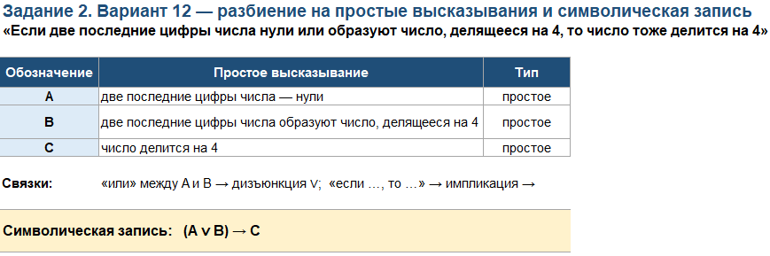
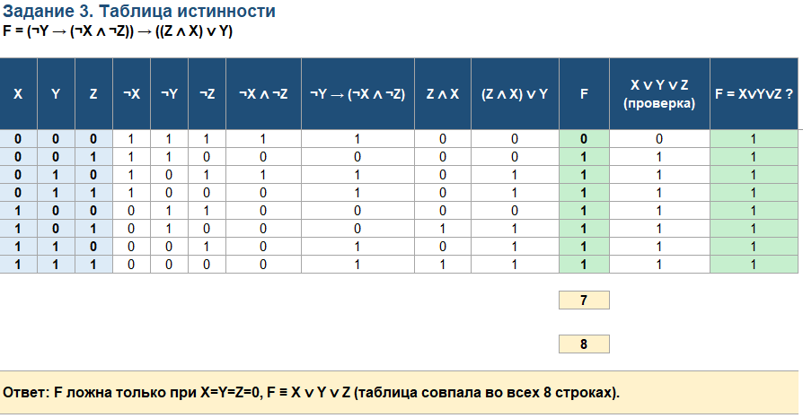

# Домашнее задание №1 — Алгебра логики (вариант 12)

Все расчёты выполнены **в Excel** — логические операции построены на функциях `ЕСЛИ`, `И`, `ИЛИ`, а
правильность преобразований подтверждена сравнением столбцов таблиц истинности.

---

## Условие

Вариант **12**.

| № | Задание |
|:-:|---|
| 1 | $\overline{(X>2)} \lor (X<2) \lor (X>4)$ при $X=3$ — определить, истинно ли высказывание |
| 2 | «Если две последние цифры числа нули или образуют число, делящееся на 4, то число тоже делится на 4» — разбить на простые высказывания и записать символически |
| 3 | $\left(\overline{Y} \to (\overline{X} \land \overline{Z})\right) \to (Z \land X \lor Y)$ — построить таблицу истинности |

---

## Скриншоты

#### [Задание 1:](/excel/task1.xlsx)

#### [Задание 2:](/excel/task2.xlsx)

#### [Задание 3:](/excel/task3.xlsx)
